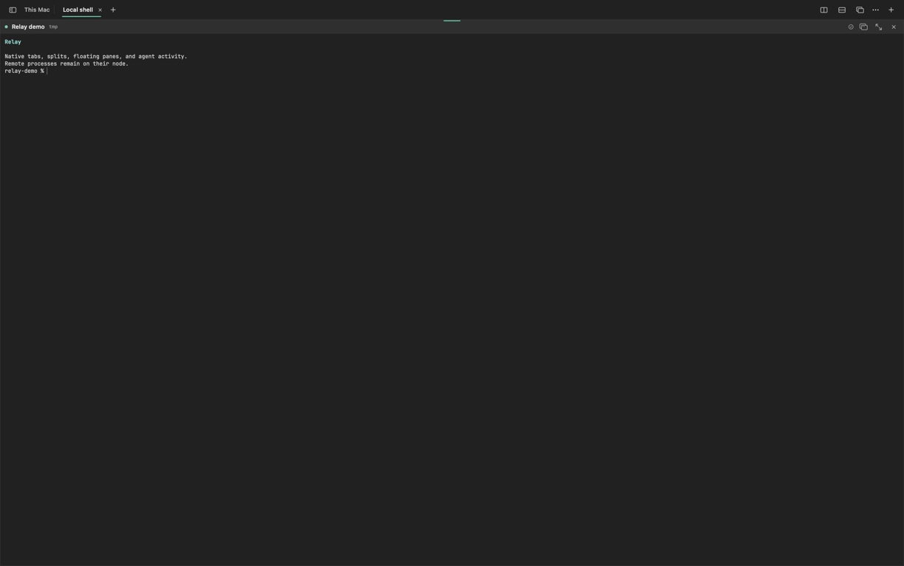

# Relay

Relay is a native macOS workspace for durable shells and agents running on remote nodes.



## Install

Relay requires macOS 14 or later. Download [Relay 0.5.2 for macOS](https://github.com/genomewalker/relay-terminal/releases/latest/download/Relay-0.5.2-macOS.dmg), open the DMG, and drag Relay to Applications. The release is signed and notarized.

On first launch, choose a host from `~/.ssh/config`. Relay explains the remote helper before installing it; use **Remote -> Manage relayd...** to approve installation and inspect its version, sessions, panes, status, and bounded log. The helper is installed under the remote user's home directory and does not require `sudo` or a listening TCP port.

This is a pre-1.0 release. Closing a pane detaches it by default so its remote process keeps running. Use the explicit terminate action when the process should end.

From a Relay-managed remote shell, `rcode file.py` opens the file in a floating Monaco pane over the terminal. Use `rcode --diff file.py` for a Git `HEAD` comparison or `rcode --diff old.py new.py` for a two-file comparison. The editor renders locally; only file operations run remotely.

Shells and agents run on the selected remote node. Tabs, splits, mouse interaction, context menus, and rendering are handled by the Mac application.

## Plugins and plugin development

Relay's experimental plugin system uses versioned JSON packages from public
GitHub releases. Packages can provide information, HTTPS links, and native tools
implemented by Relay. They do not execute downloaded code or run VS Code extensions.

See the **[Plugin development guide](docs/PLUGIN-DEVELOPMENT.md)** for a starter
manifest, API versions, permissions, local testing, publishing, installation and
how to contribute new operations to Relay. The [architecture and roadmap](docs/PLUGIN-SYSTEM.md)
and [current validation status](docs/plugins/CURRENT-ACCEPTANCE.md) distinguish
working-copy features from installed or released builds. A published plugin may
require a newer compatible Relay app and `relayd` than the public DMG.

Development packages: [HPC jobs](docs/plugins/hpc-jobs/README.md),
[artifacts](docs/plugins/artifacts/README.md),
[agent activity](docs/plugins/agent-activity/README.md),
[Git review](docs/plugins/git-review/README.md),
[transfers](docs/plugins/transfers/README.md),
[project actions](docs/plugins/project-actions/README.md), and
[Radian](docs/plugins/radian/README.md). These pages describe working-copy
features and limits; manual installed-app acceptance is still pending.

## Current architecture

```text
Relay.app (macOS)
  native tabs + split tree + session rail
  GhosttyKit Metal terminal surface per pane
  authenticated loopback WebSocket + xterm surface for the Codex app panel
                 │ one multiplexed framed stream over `ssh -T` per node
                 ▼
relayd supervisor (remote, static Go binary)
  session catalog + layout state + connection multiplexer
                 │ private Unix socket
                 ▼
relay worker per pane
  durable session UUID → PTY → shell / Claude / Codex
  output replay + resize/input + structured agent events
```

A local pane maps one-to-one to a durable remote `relayd` session UUID. Splitting a remote pane creates another PTY on the same remote host and asks it to inherit the parent shell's working directory; only the visual divider is local. Closing a remote pane detaches it, so the process survives and the saved workspace can reattach later.

Relay preserves the ordered terminal parser while the app is inactive so alternate-screen state, keyboard modes, and cursor geometry cannot drift. Optional artifact analysis, legacy transcript heuristics, and on-device model work pause; hidden Ghostty surfaces retain their last frame and their Metal display links idle naturally. Output is coalesced and all replay buffers remain bounded. Screen-cache writes are debounced, identical snapshots are skipped, and each cache records its remote output cursor so relaunches request only bytes newer than the cached screen. Pane and agent channels share one reconnecting SSH node stream. On the remote node, idle process detection and worker-manifest persistence use adaptive backoff; active agents retain the faster polling intervals.

The Ghostty in-memory bridge uses one coalescing writer per surface and applies backpressure at an 8 MiB queue budget. It does not create one retained dispatch closure per SSH packet. Relay exports ten-second aggregate batch and queue-depth measurements in diagnostics, while Instruments signposts remain available for focused profiling. Relay pins the tested bridge revision from the public [`genomewalker/libghostty-spm`](https://github.com/genomewalker/libghostty-spm/tree/codex/bounded-output-queue) fork until the change is available upstream.

`relayd` and its pane workers listen only on mode-0600 Unix sockets owned by the remote user. SSH remains the authentication and transport layer; Relay opens no remote TCP port. Killing the supervisor does not close pane PTYs. A replacement supervisor validates each worker's node boot ID, PID start time, manifest, and socket handshake before reattaching. Older relayd versions fall back to one SSH stream per pane until they are updated.

## What works

- Native session-scoped tabs, recursive splits, draggable dividers, four-edge pane docking, floating panes, focus, selection, rename actions, and right-click menus
- GhosttyKit terminal rendering with Metal, true color, Unicode, links, and mouse protocols
- Detached per-pane workers with atomic manifests and supervisor-crash recovery
- Persistent remote PTYs with detach/reattach and an 8 MiB output replay ring
- Remote split creation with parent-session working-directory inheritance on Linux HPC nodes
- `~/.ssh/config` host discovery, including `Include` files; OpenSSH still resolves ProxyJump, IdentityFile, HostName, User, and Port
- Saved manual host profiles and direct SSH fallback
- Structured Claude and Codex hook events for normal agent launches inside Relay, with process-tree and output fallback detection
- Native session-rail states for working, ready, needs input, exited, and active Claude subagents
- A clickable agent-thread tree with structured tool events and identity-aware subagents; raw terminal lines never enter the sidebar
- A persistent, deduplicated "since you last checked" agent inbox spanning nodes, sessions, tabs, panes, Codex, and Claude
- An authenticated loopback terminal in Codex's right panel, grouped by Relay session and tab, with the selected pane's live PTY byte stream, keyboard input, resize, images, agent/subagent state, and pane reveal; it attaches to the existing Relay pane and opens no remote port or second shell
- Safe multi-view attachment for that terminal: the focused client owns input and the single canonical PTY geometry, while clients at other widths render the same grid as read-only clipped/scrollable views; changing focus transfers ownership with one authoritative resize instead of creating resize races
- Exact agent summaries, focus ranking, lexical activity search, and a directional peer-coordination view that do not require a model. Optional Apple Foundation Models refinement is experimental, disabled by default, serialized, rate-limited, and never runs while Relay is inactive
- Node-scoped remote catalogs that discover validated detached panes before starting a new shell; older panes migrate as recoverable entries
- Sequence-based output reconnect plus acknowledged, deduplicated input for new workers; old workers remain protocol-compatible
- Persistent bounded agent-event journals with cursor replay, including a supervisor compatibility index for older workers
- Inline Kitty-graphics rendering or dismissible native previews for PNG/JPEG/GIF/WebP files referenced by remote Codex or Claude output
- Type-aware terminal links: web URLs open in the local browser, remote images open in Relay's viewer, and remote source/text paths open in a floating `rcode` pane
- Finder drag-and-drop and file paste into remote panes; relayd resolves the pane process's live working directory at transfer time, never overwrites, and inserts the resulting remote path at the prompt
- Native prompt editing in shell, Codex, and Claude panes; agent mouse reporting is bypassed only after a real selection drag begins, Shift/Option-Shift/Command-Shift arrows select by character/word/line, Delete removes only selected live input, typing replaces it, and `⌘Z` / `⇧⌘Z` provide bounded prompt undo/redo. Bracketed multiline paste is preserved for agent prompts. Terminal input opts out of macOS autocorrection, inline prediction, completion, and Writing Tools
- A bundled `xterm-relay` terminal identity derived from the Ghostty capabilities Relay uses. Local and remote setup install it idempotently by content hash and set `TERM=xterm-relay` only after resolution succeeds; otherwise sessions use `xterm-256color`
- Live macOS Settings (`⌘,`) for font, size, terminal padding, palette, interface density, full-screen chrome, and artifact previews
- Workspace restoration using stable pane/session UUIDs
- One persistent SSH transport per connected node, with independent virtual pane and agent channels; protocol heartbeats replace even a completely frozen SSH process in about ten seconds
- Remote workspace snapshots for tabs, split geometry, floating panes, editor panes, and selection
- Per-pane input ownership and short remote-layout leases for safe multi-client attachment
- Explicit terminate/forget commands and startup-bounded retention GC that never selects running panes

Relay deliberately does not run Zellij or tmux for its layout. They can still run inside a pane, but doing so gives their text UI control of that pane again.

## Build and run

Requirements: macOS 14+, Xcode 26+, and Go 1.24+ for building the remote daemon.

```bash
swift test
./scripts/build-app.sh release
open Relay.app
```

The build script installs the runnable development bundle at
`~/Applications/Relay.app` and links `Relay.app` in the repository to it. This
keeps code signing stable when the source tree is managed by macOS File Provider.

Relay announces the remote helper on first launch. Open **Remote → Manage
relayd…** to check each SSH node, inspect the supervisor, session and pane
counts, read its bounded log, or explicitly authorize installation. Release
apps contain static Linux binaries for amd64 and arm64 inside the signed app.
Relay uploads the matching payload over SSH, verifies SHA-256 on the host, and
atomically installs it under `~/.local/share/relay/bin/`. The small
`~/.local/bin/relayd` launcher selects the correct payload at runtime, so amd64
and arm64 nodes can safely share one home. Each node has its own authenticated
supervisor socket in a private mode-0700 runtime directory. Relay never uses
`sudo` and never opens a remote TCP port. Automatic updates are opt-in and
apply only after the first explicit installation approval for that host.

The development installer remains available:

```bash
./scripts/install-relayd.sh <ssh-host>
```

The first Relay connection starts the per-user daemon automatically.

An attachment probe timing out no longer replaces a worker whose process is
still alive. Relay retries the attachment and preserves the existing PTY.
For sessions affected by older versions creating duplicate workers, recover
the intended worker on its Linux host:

```bash
relayd recover --session <pane-session-id> --worker-pid <existing-relayd-worker-pid>
```

Use the worker PID, not the Claude/Codex PID. Recovery checks process ownership,
session identity, and socket authentication, then records the selected worker
separately so other legacy workers cannot overwrite the choice. Reconnect the
pane afterward. Recovery does not kill, restart, or merge any processes; if the
selected worker becomes unavailable, attachment fails instead of opening a
different shell.
If an older supervisor already deleted that worker's socket, this command
cannot reconnect it. The saved agent conversation must be resumed separately
after deciding how to handle the original process.

Relay also installs its bundled `xterm-relay` entry into the current user's terminfo database. Remote hosts receive the compiled entry from `relayd`; they do not need `tic`. Settings reports the active entry and its content hash. Programs run through `sudo` may not see a user-private entry, so Relay keeps `xterm-256color` as the safe fallback and shows an optional one-time system-install command. Relay never requests administrator access silently.

The installer adds Relay-only `claude` and `codex` shims to remote shells created by Relay. It creates an `rcode` symlink only when that name is unused or already belongs to Relay; an unrelated command is never replaced. The agent shims launch the real commands with structured hooks, while normal SSH shells keep their existing `PATH`. An explicit launch also works:

```bash
relayd agent claude
```

Create signed release artifacts with:

```bash
RELAY_CODESIGN_IDENTITY="Developer ID Application: …" \
RELAY_NOTARY_PROFILE=relay-notary \
./scripts/package-release.sh
```

The package script emits a drag-to-Applications DMG, a ZIP for automated deployment, static Linux `relayd` binaries for amd64 and arm64, and SHA-256 checksums. Public packaging requires a Developer ID and notary profile, then notarizes and staples both the app and its DMG. GitHub Actions mounts every generated DMG and verifies the app executable, Applications shortcut, and code signature; tagged releases use the signing and Apple notarization secrets documented in the release workflow.

Install a release by opening `Relay-<version>-macOS.dmg` and dragging Relay to Applications. macOS updates replace only the local application; remote workers and workspace state remain on their nodes and reattach on launch.

### Claude prompt editor bridge

New Relay shells enable the private Claude editor bridge at launch. Claude still runs its official CLI; the bridge captures the editor file for read-only prompt inspection. Set `RELAY_PROMPT_EDITOR_ENABLE=0` before launching a shell or Claude to disable it. Existing provider processes keep their launch environment. Cmd+A uses the viewport fallback when the running provider lacks a verified bridge; an uncertain editor transaction preserves input for recovery.

## Keyboard

Press `⌘Q` twice within two seconds to quit Relay. Holding the keys does not count as a second press, and remote sessions remain running.

- `⌘D`: split right
- `⇧⌘D`: split down
- `⌘W`: detach/close the active pane
- `⌘Z` / `⇧⌘Z`: undo/redo edits in the anchored terminal prompt
- `⇧←` / `⇧→`: select prompt text by character
- `⌥⇧←` / `⌥⇧→`: select prompt text by word
- `⌘⇧←` / `⌘⇧→`: select to the beginning/end of the prompt line
- `⌥←` / `⌥→` and `⌘←` / `⌘→`: move by word or to the line boundary in a live prompt
- `⌥⌘[` / `⌥⌘]`: previous/next pane
- `⇧⌘Return`: zoom/restore the active pane
- `⌥⌘P`: float/dock the active pane
- `⇧⌘[` / `⇧⌘]`: previous/next tab
- `⇧⌘↑` / `⇧⌘↓`: previous/next semantic shell prompt
- `⌥⌘I`: show or hide the cross-session agent activity inbox
- `⌘,`: settings

Change Relay shortcuts in **Settings → Keyboard → Customize shortcuts**. Relay rejects duplicate assignments, lets each action be reset independently, and reserves `⌘W` for closing or detaching the active pane instead of the workspace window.

Drag a pane by its connection header and drop it near another pane's left, right, top, or bottom edge to dock it there. Drop in the center to swap tiled panes. The remote PTYs keep their identities and continue running during the move.

## Current limits

- Relay accepts versioned Codex app-server JSON-RPC and Claude stream-json events through `relayd event --stream`; the existing interactive TUIs still use structured hooks plus a transcript compatibility fallback until they emit that stream directly
- Finder transfer currently accepts regular files up to 64 MiB each; directory and resumable transfers are not implemented yet
- Multiple independent workspace windows are not supported yet; the current app owns one workspace model and one input owner per remote pane
- The local 2 MiB-per-pane screen cache is display-only; searchable command/output history is not persisted beyond the remote replay and structured event journals
- Signed public builds require the repository owner’s Developer ID and Apple notarization credentials

## Performance benchmarks

`./scripts/benchmark-relay.sh` runs repeatable wire-protocol microbenchmarks and samples idle app CPU, resident memory, and thread count once per second. It also captures before/after VM summaries and a short stack sample so memory growth and wakeup sources can be compared between builds. Set `RELAY_BENCHMARK_SECONDS` to change the sample window. The script prints an `xctrace` Energy Log command for battery measurements; the trace stays separate because Instruments needs an interactive capture session.

## License

No project license has been selected. Public source visibility does not grant redistribution rights. Third-party packages retain their own licenses.

### Configure the running app without UI automation

The authenticated settings API exposes all main terminal, workspace, artifact,
AI, remote-update preferences and keyboard bindings. Changes apply immediately
through the same native model as Settings. Credentials and MCP grants are not
writable settings. Plugin installation and host management remain separate operations.

```bash
./scripts/relay-settings.py get
./scripts/relay-settings.py schema
./scripts/relay-settings.py get intelligence_enabled
./scripts/relay-settings.py set intelligence_enabled true
./scripts/relay-settings.py set font_size 13.5
./scripts/relay-settings.py update --file preferences.json
```

MCP clients can use `relay_get_settings` and `relay_update_settings`. Updates
require the current instance, expected revision, stable request UUID and typed
`changes` object. Existing workspace configuration permission is required.
Invalid values, unknown keys, shortcut conflicts and stale revisions are rejected
before any write. Reuse the same request UUID and payload after an uncertain
response; do not create a new request automatically. An empty `key_bindings`
object resets all shortcuts; otherwise supply the complete override map.

For a graceful restart or signed update:

```bash
./scripts/restart-relay.py
./scripts/restart-relay.py --candidate /path/to/Relay.app
```

### Native agent rendering

The conversation view renders the provider transcript belonging to the verified Claude Code or Codex process in the same pane. The official CLI keeps ownership of the agent loop, tools, permissions, configuration, authentication, and session history. Relay does not launch a replacement SDK worker or app-server session for this view.

Activity notifications refresh the native timeline. Native prompt submission uses the original terminal transport only after checking the exact session binding, authenticated idle state, and empty prompt. When these checks are unavailable, use the Terminal button for provider controls. Persistent remote panes use the same verified binding, idle-state, and empty-prompt checks as local panes. Direct SSH falls back to terminal controls when those checks are unavailable.
